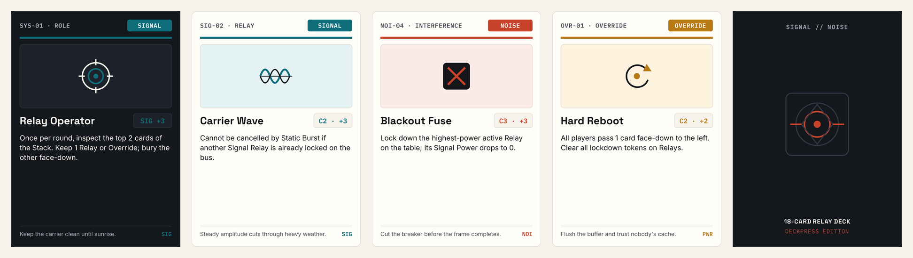
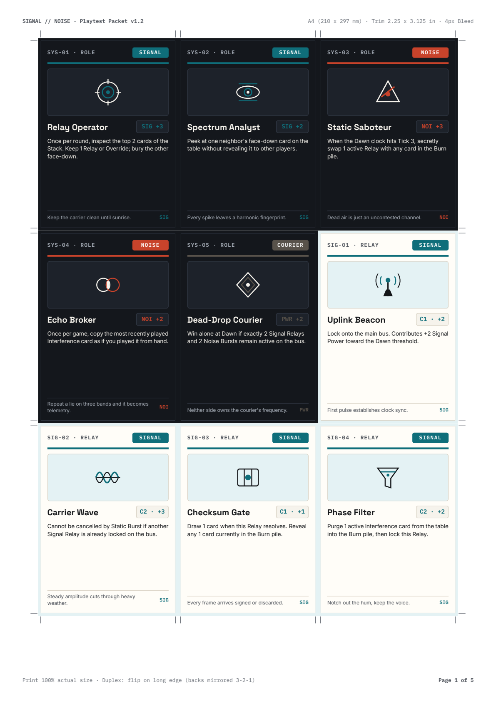
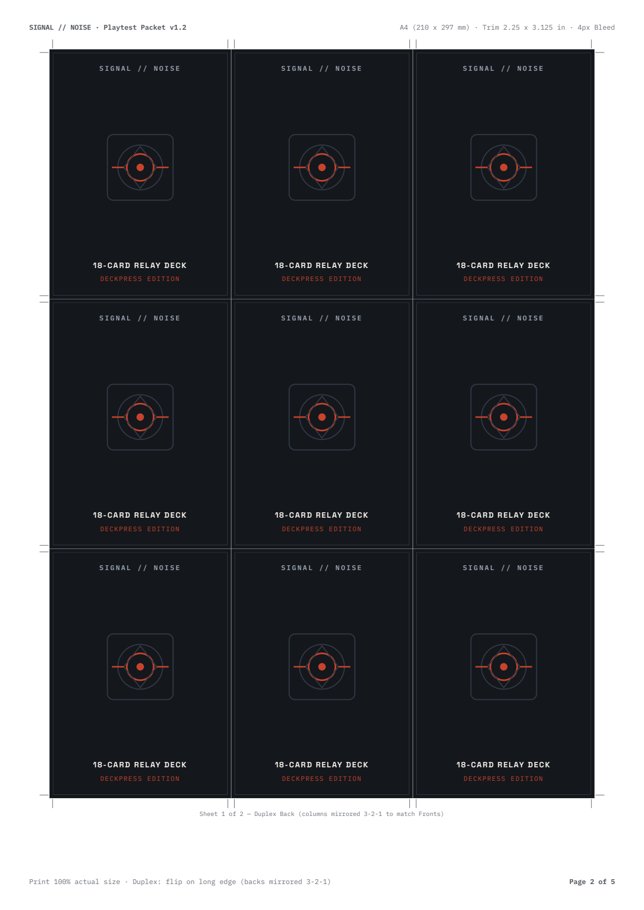
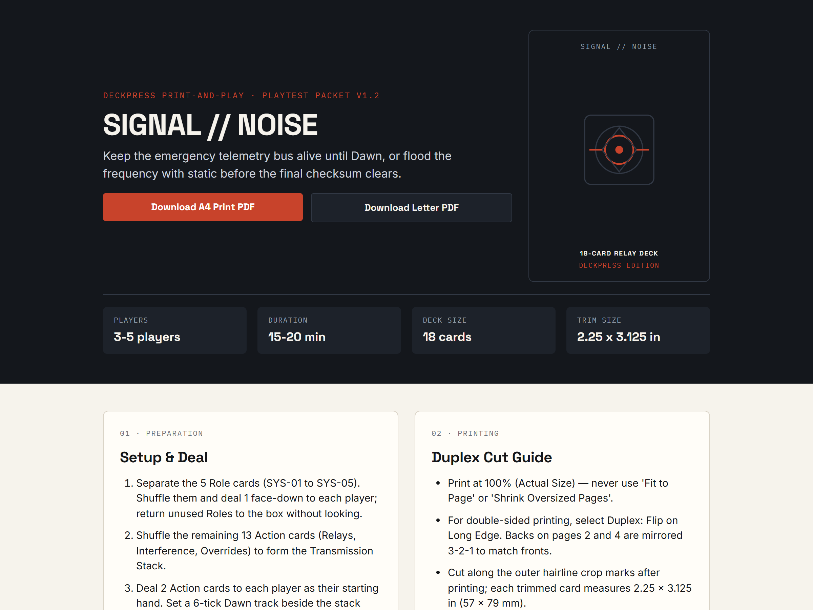
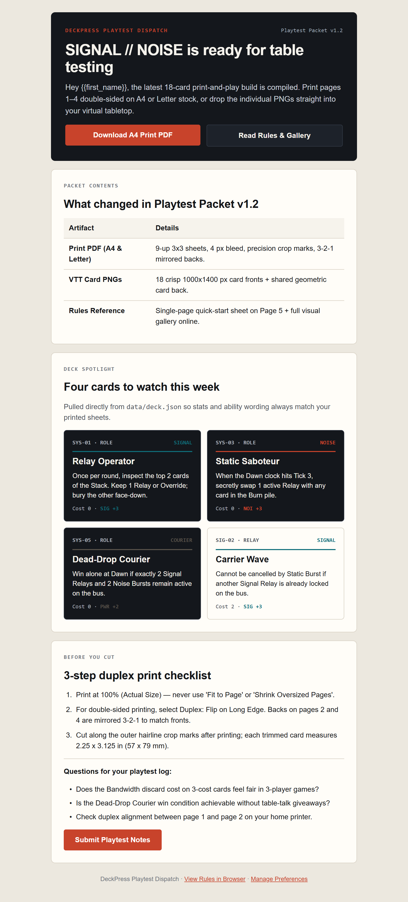

# DeckPress — Print-and-Play Card Deck Kit

**DeckPress** compiles a single JSON card deck (`data/deck.json`) and one shared [Hyper Elements](https://github.com/hyper-elements/hyper-elements) React component tree into four production formats:

1. **Print-and-Play PDF** (`out/deck-a4.pdf`, `out/deck-letter.pdf`) via `<Document>` + `renderPdf()`
2. **Virtual Tabletop Card PNGs** (`out/cards/*.png`) via `<Canvas>` + `renderImage()`
3. **Rules & Card Gallery Page** (`out/rules.html`) via `<Page>` + `render()`
4. **Playtester Dispatch Email** (`out/playtest-email.html`, `out/playtest-email.txt`) via `<Email>` + `render()`

The bundled deck is **SIGNAL // NOISE**, an original 18-card asymmetric relay and interference game for 3–5 players. Every card emblem is drawn in pure Hyper Elements `<Svg>` primitives (`Rect`, `Circle`, `Ellipse`, `Line`, `Polygon`, `Path`), so the exact same artwork scales across vector PDF sheets, 2x PNG exports, and responsive HTML.



## Why Hyper Elements fits a print-and-play workflow

Card games normally force you to maintain four separate pipelines: InDesign or Scribus for print sheets, Photoshop/Figma exports for Tabletop Simulator, Markdown/HTML for rules, and MJML or table hacks for playtester emails. Whenever a card's cost or wording changes, one of those targets drifts out of sync.

DeckPress keeps all four targets pinned to `data/deck.json` and one shared `defineTheme()` design system (`src/theme.ts`):

| Target | Hyper Elements Root | Renderer | Key Output Details |
|---|---|---|---|
| Print Sheets | `<Document>` + `<Document.Page>` | `@hyper-elements/react/pdf` | 5-page A4 & US Letter PDFs, 3x3 card grids, 4 px full bleed, vector crop marks, 3-2-1 mirrored backs, 1-page tabletop rules |
| VTT Cards | `<Canvas>` | `@hyper-elements/react/image` | 18 card fronts + 1 card back at `1000x1400` px (`scale: 2`, `strict: true`) |
| Web Gallery | `<Page>` + `<Grid>` | `@hyper-elements/react` | Self-contained responsive rules sheet + visual card index |
| Playtest Mail | `<Email>` + `<Section>` | `@hyper-elements/react` | Outlook/Gmail-safe table HTML + plain-text fallback, checked via `@hyper-elements/email-clients` |

## Print engineering: bleed, crop marks, and duplex mirroring

Home printers flip double-sided sheets along the long edge. If card backs sit in the same left-to-right column order as card fronts, column 1 on the front ends up behind column 3 on the back.

`src/layout-math.ts` chunks the 18-card deck into 9-card sheets (`3x3`), keeps each card at a `216x300` px trim box (`2.25 x 3.125 in` at 96 dpi) wrapped in a `4` px full-bleed apron (`224x308` px cell), and surrounds the grid with `<Svg>` hairline crop marks aligned to every trim edge. On even-numbered pages, `mirrorSheetRows()` reverses each row (`[0, 1, 2] -> [2, 1, 0]`) so double-sided prints align cleanly when cut.

| Sheet 1 Front (Pages 1 & 3) | Sheet 1 Duplex Back (Pages 2 & 4) |
|---|---|
|  |  |

## Rules page & playtester dispatch email

The web page (`out/rules.html`) reuses the exact `<CardFront />` and `<CardBack />` components inside `<Grid columns={3}>`. For `<Email>` (`out/playtest-email.html`), where email clients drop `<svg>` elements, `<CardEmailTile />` renders a table-safe card preview from the same `CardSpec` data and theme tokens.

| Rules & Card Gallery (`<Page>`) | Playtester Dispatch (`<Email>`) |
|---|---|
|  |  |

## Quick start

Requires Node.js 20.6 or later.

```bash
npm install
npm run build
```

Generated artifacts appear in `out/`:
- `out/deck-a4.pdf` and `out/deck-letter.pdf`
- `out/cards/*.png` (18 card fronts + `card-back.png`)
- `out/rules.html`
- `out/playtest-email.html` and `out/playtest-email.txt`

To build only one paper size:

```bash
npm run build:a4
npm run build:letter
```

## Validation, email client checks, and tests

Run TypeScript checks, Hyper Elements `validate()` + `outline()` + `@hyper-elements/email-clients` emulation (`outlook`, `gmail`, `apple-mail`, `gmail-app`), and the unit/integration test suite:

```bash
npm run typecheck
npm run check
npm test
```

## Project structure

```text
data/
  deck.json                 Single source of truth for rules and all 18 cards
src/
  types.ts                  DeckData and CardSpec types
  data.ts                   JSON loader
  fonts.ts                  Offline WOFF loader (@fontsource) for PDF & Canvas
  theme.ts                  Shared Hyper Elements defineTheme() tokens & styles
  layout-math.ts            3x3 sheet chunking, crop offsets, 3-2-1 duplex mirroring
  components/
    CardEmblem.tsx          18 geometric <Svg> emblems + card-back mark
    CardFace.tsx            Shared CardFront, CardBack, and CardEmailTile components
  templates/
    DeckDocument.tsx        <Document> print-and-play PDF template
    CardCanvas.tsx          <Canvas> VTT PNG template
    RulesPage.tsx           <Page> rules and full visual card gallery
    PlaytestEmail.tsx       <Email> playtester dispatch template
  build.ts                  End-to-end generator for all 4 outputs
  check.ts                  validate(), outline(), and email-client emulator checks
  deck.test.ts              Schema, duplex math, validation, and render tests
```

## Credits & License

- Card typography uses **Space Grotesk**, **Inter**, and **IBM Plex Mono** packaged via `@fontsource/*` (SIL Open Font License 1.1).
- Built with [Hyper Elements](https://github.com/hyper-elements/hyper-elements) (MIT).
- Code and original **SIGNAL // NOISE** deck content by **olaph**, released under the [MIT License](./LICENSE).
